# Architecture & Technical Specifications — La Torrentola 🏗️⚡

Comprehensive technical documentation covering the system architecture, design patterns, media pipelines, networking engines, audio transcoding, hybrid persistence, security models, and formal workflows of **La Torrentola**.

---

## 📑 Table of Contents
1. [System Architecture Overview](#1-system-architecture-overview)
2. [Tech Stack & Toolchain](#2-tech-stack--toolchain)
3. [Setup, Build & Testing Guidelines](#3-setup-build--testing-guidelines)
4. [UI Architecture & Surface Design](#4-ui-architecture--surface-design)
5. [Core Subsystems](#5-core-subsystems)
   - [5.1 Dual-Catalog Engine (Movies & TV Series)](#51-dual-catalog-engine-movies--tv-series)
   - [5.2 OTT Watch Providers & Platform Discovery](#52-ott-watch-providers--platform-discovery)
   - [5.3 In-App Torrent Streaming & Verified HTTP Server](#53-in-app-torrent-streaming--verified-http-server)
   - [5.4 High-Performance Network Storage (SMB & NFS)](#54-high-performance-network-storage-smb--nfs)
   - [5.5 Storage Management & Removable Media](#55-storage-management--removable-media)
   - [5.6 Digital Audio Engine & AC3 Surround Transcoding](#56-digital-audio-engine--ac3-surround-transcoding)
   - [5.7 Video Playback & Google Cast Ecosystem](#57-video-playback--google-cast-ecosystem)
   - [5.8 Canonical Watch History & Cross-Source Resume](#58-canonical-watch-history--cross-source-resume)
   - [5.9 Cloud Library, FCM & Google Identity](#59-cloud-library-fcm--google-identity)
   - [5.10 Hardware Keystore & Security Model](#510-hardware-keystore--security-model)
   - [5.11 R8, ProGuard & App Shrinking Architecture](#511-r8-proguard--app-shrinking-architecture)
6. [Complete Suite of Sequence & Flow Diagrams](#6-complete-suite-of-sequence--flow-diagrams)

---

## 1. System Architecture Overview

La Torrentola is engineered following **Android Clean Architecture** principles paired with a reactive **MVI/MVVM (Model-View-Intent / Model-View-ViewModel)** unidirectional data flow. The application runs as a **Single-Activity App** powered by Jetpack Compose and AndroidX Navigation 3.

```mermaid
graph TD
    subgraph UI_Layer ["UI Layer - Jetpack Compose & TV Material 3"]
        MA["MainActivity"]
        NV["AppNavigation - Navigation 3"]
        LS["LoginScreen"]
        HS["HomeScreen"]
        DS["MovieDetailScreen"]
        SS["SearchScreen"]
        STS["SettingsScreen"]
        TVGR["TvGenreResultsScreen"]
        TVDS["TvDetailScreen"]
        TVES["TvEpisodeDetailScreen"]
        TDS["TorrentDownloadsScreen"]
        EMBS["ExternalMediaBrowserScreen"]
        OPS["OttProvidersScreen"]
        OCS["OttCatalogScreen"]
        LPA["LocalPlayerActivity"]
    end

    subgraph Presentation_Layer ["Presentation Layer - ViewModels"]
        AVM["AuthViewModel"]
        HVM["HomeViewModel"]
        DVM["DetailViewModel"]
        SVM["SearchViewModel"]
        STVM["SettingsViewModel"]
        TVHVM["TvHomeViewModel"]
        TVGVM["TvGenreResultsViewModel"]
        TVDVM["TvDetailViewModel"]
        TVEVM["TvEpisodeDetailViewModel"]
        TDVM["TorrentDownloadsViewModel"]
        EMBVM["ExternalMediaBrowserViewModel"]
        OPVM["OttProvidersViewModel"]
        OCVM["OttCatalogViewModel"]
        TPVM["TvPlayerViewModel"]
    end

    subgraph Domain_Services ["Domain & Core Services Layer"]
        TDS_SVC["TorrentDownloadService - Foreground"]
        HTTP["VerifiedTorrentHttpServer - NanoHTTPD"]
        RSM["RemoteStorageManager"]
        SMB["SmbStorageClient - smbj 0.15.0"]
        NFS["NfsStorageClient - native libnfs JNI"]
        PREFETCH["SmbPrefetchInputStream - 16 MB Buffer Pool"]
        RMDS["RemoteMediaDataSource - Media3"]
        RMHTTP["RemoteMediaHttpServer - Cast Proxy"]
        AUD_SINK["Ac3TranscodingAudioSink - Surround DSP"]
        MMR["MediaMetadataResolver & Canonical IDs"]
        TSR["TorrentStorageResolver & USB Inspector"]
    end

    subgraph Data_Layer ["Data Layer - Repositories & Databases"]
        AREP["AuthRepository"]
        UREP["UserLibraryRepository - Firestore Sync"]
        REP["YtsRepository / YtsService"]
        TR["TmdbRepository / TmdbService"]
        ER["EztvRepository / EztvService"]
        TIOR["TorrentioRepository / Service"]
        TEPR["TvEpisodeReleasesRepository"]
        OMDBR["OmdbRepository / OmdbService"]
        PTR["PublicTrackersRepository"]
        OSR["OpenSubtitlesRepository / Store"]
        FCMR["FcmRepository / FcmService"]
        DB["AppDatabase - Room"]
        WDAO["WatchHistoryDao"]
        TDAO["TorrentDownloadDao"]
        TVGDAO["TvGenreDao"]
        GENDAO["GenreDao"]
        MLK["Google ML Kit Translator"]
        PM["PreferenceManager"]
        SMBCS["SmbCredentialStore - Keystore"]
    end

    subgraph External ["External Services, Devices & Storage"]
        YTS["YTS Movie Catalog API"]
        TMDB["TMDB Catalog & Watch Providers"]
        EZTV["EZTV Torrent API"]
        TIO["Torrentio Scraper API"]
        OMDB["OMDb Ratings API"]
        OSAPI["OpenSubtitles REST API"]
        FCMBE["Firebase Cloud Messaging"]
        FIREBASE["Firebase Auth & Firestore"]
        CAST["Google Cast CAF Receivers"]
        NAS["Home NAS / PC - SMBv2/v3 & NFSv3/v4"]
        USB_DEV["USB Storage / Removable Media"]
    end

    MA --> NV
    NV --> LS
    NV --> HS
    NV --> DS
    NV --> SS
    NV --> STS
    NV --> TDS
    NV --> EMBS
    NV --> OPS
    NV --> OCS
    NV --> TVGR
    NV --> TVDS
    NV --> TVES
    MA --> LPA

    LS --> AVM
    HS --> HVM
    HS --> TVHVM
    DS --> DVM
    SS --> SVM
    STS --> STVM
    TVGR --> TVGVM
    TVDS --> TVDVM
    TVES --> TVEVM
    TDS --> TDVM
    EMBS --> EMBVM
    OPS --> OPVM
    OCS --> OCVM
    LPA --> TPVM

    AVM --> AREP
    AREP --> FIREBASE

    HVM --> REP
    HVM --> UREP
    DVM --> REP
    DVM --> TR
    DVM --> OMDBR
    DVM --> MLK
    DVM --> UREP

    TVHVM --> TR
    TVGVM --> TR
    TVDVM --> TR
    TVEVM --> TEPR
    TEPR --> TIOR
    TEPR --> ER
    TEPR --> TR

    OPS --> OPVM
    OPVM --> TR
    OCS --> OCVM
    OCVM --> TR

    STVM --> PM
    STVM --> FCMR
    STVM --> UREP
    STVM --> TSR

    TDVM --> TDAO
    TDVM --> TDS_SVC

    EMBVM --> RSM
    EMBVM --> SMBCS
    EMBVM --> TSR

    LPA --> TDS_SVC
    LPA --> HTTP
    LPA --> RSM
    LPA --> RMDS
    LPA --> RMHTTP
    LPA --> AUD_SINK
    LPA --> MMR
    LPA --> WDAO
    LPA --> UREP
    LPA --> OSR
    LPA --> CAST

    RSM --> SMB
    RSM --> NFS
    SMB --> PREFETCH
    SMB --> NAS
    NFS --> NAS
    RMHTTP --> CAST
    TSR --> USB_DEV

    REP --> YTS
    TR --> TMDB
    ER --> EZTV
    TIOR --> TIO
    OMDBR --> OMDB
    OSR --> OSAPI
    FCMR --> FCMBE
    UREP --> FIREBASE
    TDS_SVC --> PTR
    TDS_SVC --> HTTP
    TDS_SVC --> TDAO
    DB --> WDAO
    DB --> TDAO
    DB --> TVGDAO
    DB --> GENDAO
```

---

## 2. Tech Stack & Toolchain

* **Language**: [Kotlin 2.1+](https://kotlinlang.org/) utilizing the Kotlin K2 compiler with strong skipping mode enabled for Jetpack Compose.
* **Target SDKs**: `minSdk = 28` (Android 9.0 Pie, required for high-performance JNI and libtorrent4j), `targetSdk = 35`, `compileSdk = 35`.
* **UI Framework**:
  * **Handheld / Foldables / Tablets**: Jetpack Compose with Material 3 (`androidx.compose.material3`).
  * **Android TV & Google TV**: Jetpack Compose for TV (`androidx.tv.material3`, `androidx.tv.foundation`).
  * **Visual Polish**: [Haze 2.0](https://github.com/chrisbanes/haze) hardware-accelerated frosted glass blur using `RenderEffect` on Android 12+ (API 31+).
* **Dependency Injection**: [Hilt](https://developer.android.com/training/dependency-injection/hilt-android) with `@HiltViewModel` lifecycle scoping.
* **Navigation**: [AndroidX Navigation 3](https://developer.android.com/jetpack/androidx/releases/navigation) Compose-first backstack with polymorphic `@Serializable` `Route` contracts.
* **Media & Audio Subsystem**:
  * [Media3 ExoPlayer 1.5+](https://developer.android.com/media/media3/exoplayer) with custom `LoadControl`, `RenderersFactory`, and `RemoteMediaDataSource`.
  * Software Audio Fallback via [Media3 FFmpeg Decoder](https://developer.android.com/media/media3/exoplayer/customizing-playback#ffmpeg-extension).
  * [Google Cast SDK CAF](https://developers.google.com/cast) integration via `CastContext`, `SessionManager`, and `RemoteMediaClient`.
  * Custom real-time surround transcoding audio sink (`Ac3TranscodingAudioSink`).
* **P2P Torrent Engine**: [libtorrent4j](https://github.com/aldenml/libtorrent4j) (native C++ libtorrent 1.2+ bindings via JNI) with custom piece tracker (`VerifiedPieceTracker`), piece planner (`StreamingPiecePlanner`), and HTTP byte-range server (`VerifiedTorrentHttpServer`).
* **Remote Network Storage**:
  * **SMB**: [smbj 0.15.0](https://github.com/hierynomus/smbj) with persistent session pooling and asynchronous chunk prefetching (`SmbPrefetchInputStream`).
  * **NFS**: Native C [libnfs](https://github.com/sahlberg/libnfs) JNI bindings (`LibNfsNative.kt`) supporting NFSv3 and NFSv4.
* **Networking & Web APIs**:
  * [Retrofit 3.0](https://square.github.io/retrofit/) with [OkHttp 5](https://square.github.io/okhttp/) and Kotlin Coroutines `Flow`.
  * [NanoHTTPD](https://github.com/NanoHttpd/nanohttpd) embedded micro-servers for loopback byte-range delivery and Cast LAN streaming.
* **Cloud & Persistence**:
  * [Room 2.6+](https://developer.android.com/training/data-storage/room) as the fast, reactive Single Source of Truth for local state.
  * [Firebase Auth](https://firebase.google.com/docs/auth) with Google Credential Manager API.
  * [Cloud Firestore](https://firebase.google.com/docs/firestore) for multi-device cloud synchronization.
  * [Firebase Cloud Messaging](https://firebase.google.com/docs/cloud-messaging) for release notifications and deep linking.
* **On-Device AI**: [Google ML Kit Translate](https://developers.google.com/ml-kit/language/translation) for offline, zero-data summary translation.
* **Security**: Android Hardware Keystore (`AndroidKeyStore`) with AES-GCM 256-bit envelope encryption for network and third-party credentials.

---

## 3. Setup, Build & Testing Guidelines

### 3.1 Environment Prerequisites & Secret Injection
API keys and secrets MUST NEVER be hardcoded into version control. They are injected at build time via `local.properties`:

```properties
# Root local.properties
FIREBASE_WEB_CLIENT_ID=your_firebase_web_client_id.apps.googleusercontent.com
TMDB_API_KEY=your_tmdb_api_key_v3
OPEN_SUBTITLES_API_KEY=your_opensubtitles_api_key
```

* **Google Services Configuration**: Place the generated `google-services.json` inside the `app/` folder. Ensure the SHA-1 and SHA-256 fingerprint hashes match your local keystore.
* **Java Toolchain**: Java 17+ (Android Studio JetBrains Runtime / OpenJDK 17). Toolchain auto-detection can be configured via `gradle.properties`:
  ```properties
  org.gradle.java.installations.auto-detect=false
  ```

### 3.2 CLI Commands

#### Windows (PowerShell Core `pwsh` or Windows PowerShell):
```powershell
# Compile debug APK
pwsh -Command ".\gradlew.bat assembleDebug"

# Install on connected device/emulator
pwsh -Command ".\gradlew.bat installDebug"

# Run unit tests (Primary agent verification task)
pwsh -Command ".\gradlew.bat testDebugUnitTest"

# Generate JaCoCo code coverage report
pwsh -Command ".\gradlew.bat testDebugUnitTest jacocoTestReport"
```

#### Linux / macOS (POSIX Bash):
```bash
# Make wrapper executable
chmod +x ./gradlew

# Compile debug APK
./gradlew assembleDebug

# Run unit tests
./gradlew testDebugUnitTest
```

### 3.3 Git Submodules & Agent Skills Architecture
The repository uses Git Submodules to manage native external libraries and AI Agent Skills:
* **Native C/C++ Submodules**:
  * `app/src/main/cpp/libnfs`: High-performance userspace NFS client library.
  * `app/src/main/cpp/ffmpeg`: FFmpeg audio decoding pipeline.
* **Agent Skills Submodules ([Agent Skills Standard](https://agentskills.io/))**:
  * `.agents/skills` (`https://github.com/android/skills.git`): Official Android development skills (Compose TV, Navigation 3, Media3, Adaptive, Security, R8, LiteRT).
  * `.agents/firebase-skills` (`https://github.com/firebase/agent-skills.git`): Official Firebase agent skills (Auth, Firestore, Security Rules, Crashlytics, Analytics, Remote Config, AI Logic).
* **Cross-IDE Directory Junctions**:
  * Windows Junction: `.android-studio\skills` ➔ `.agents\skills`
  * Windows Junction: `.agents\skills\firebase` ➔ `.agents\firebase-skills\skills`
  * This structure exposes all skills recursively to both Android Studio (`.android-studio/skills`) and Agent frameworks (Antigravity, Cursor, Claude Code, Gemini CLI at `.agents/skills`).

### 3.4 Testing Architecture
* **Unit Tests (`app/src/test/`)**: Mirror the application package structure. Powered by **JUnit4**, **MockK**, **Turbine** (for Kotlin Flow state verification), and **Google Truth**.
* **Zero APK Building Mandate for AI Agents**: In development and CI environments, running `testDebugUnitTest` is the mandatory verification step to confirm zero regressions across ViewModels, Repositories, and Utility classes.

---

## 4. UI Architecture & Surface Design

### 4.1 Surface Branching (`Context.isTvDevice()`)
La Torrentola shares 100% of its ViewModels, Repositories, and Domain logic across all form factors. The presentation layer branches at the entry points:
* **Mobile / Tablet**: Uses `androidx.compose.material3` components inside `LaTorrentolaTheme`.
* **Android TV / Google TV**: Uses `androidx.tv.material3` components inside `TvLaTorrentolaTheme`.

### 4.2 Theme Mode Propagation & Dark Mode Trap Prevention
Compose `Dialog`s, `BottomSheet`s, and isolated windows spawn in distinct Android `Window` contexts that do not inherit ambient LocalProviders. Calling `TvLaTorrentolaTheme` without passing `themeMode` resets the theme to `THEME_SYSTEM`, breaking user Dark Mode on TV.

```kotlin
// Component-level contract
val effectiveThemeMode = remember(context, themeMode) {
    themeMode ?: PreferenceManager(context).getTheme()
}
if (context.isTvDevice()) {
    TvLaTorrentolaTheme(themeMode = effectiveThemeMode) { /* TV UI */ }
} else {
    LaTorrentolaTheme(themeMode = effectiveThemeMode) { /* Mobile UI */ }
}
```

### 4.3 Haze 2.0 Real-Time Blur System
* **Hardware Acceleration**: Powered by Skia `RenderEffect` on Android 12+ (API 31+).
* **Graceful Degradation**: On devices running API < 31 or during IDE Compose Previews, the app falls back to a solid translucent container (`surface.copy(alpha = 0.90f)`).
* **Scroll-Driven Interpolation**: `hazeAlpha` dynamically interpolates between `1.0f` (at rest at the top) and `0.15f` (when scrolled) over 600 ms via `EaseInOutCubic`.

### 4.4 Android TV Focus Trapping & D-Pad Navigation
* **Single Vertical Column Tree**: Eliminates focus search dead zones between sticky headers, chips, and grid items.
* **Dialog Focus Traps**: Dialogs use `androidx.compose.ui.window.Dialog(properties = DialogProperties(usePlatformDefaultWidth = false))` with opaque container surfaces ($\alpha \ge 0.95f$) to prevent D-pad events from leaking into underlying video surfaces.
* **YouTube Focus Isolation**: Embedded `YouTubePlayerView` instances are isolated (`descendantFocusability = ViewGroup.FOCUS_BLOCK_DESCENDANTS`) and overlaid with a focusable native `IconButton`.

---

## 5. Core Subsystems

### 5.1 Dual-Catalog Engine (Movies & TV Series)
* **Movie Pipeline**: Catalogs are queried from YTS via `YtsRepository`. Detail requests enrich the movie with TMDB cast/crew credits (via IMDb ID resolution), OMDb aggregated ratings (Rotten Tomatoes, Metacritic, IMDb), and on-device ML Kit summary translation.
* **TV Series Pipeline**: Powered by TMDB via `TmdbRepository` for series overview, seasons, and episodes. Episode torrent releases are resolved via `TvEpisodeReleasesRepository`, which queries both `TorrentioRepository` and `EztvRepository` (matching by numeric IMDb ID with `tt` stripped).
* **Cinematic Immersive Layouts & TMDB Logo Resolution**: Both Handheld (`HandheldTvSeriesImmersiveContainer`) and Android TV (`TvSeriesImmersiveContainer`) utilize debounced D-pad/touch focus traversal (120ms) and dynamic transparent title logo resolution (`TmdbRepository.getTvSeriesLogo`) with cooperative coroutine cancellation and language-keyed memory caching.
* **10-Foot D-Pad Accessibility on Episode Details**: `TvEpisodeDetailScreen` establishes seamless bidirectional focus bridges between top navigation, the hero episode still banner (supporting `adaptiveLongClickable` for watch progress options), and categorized torrent release lists.
* **Next Episode Continuation Evaluation**: `SeriesContinuationState` evaluates whether a subsequent episode is ready to play, unaired, or if the series has concluded.

### 5.2 OTT Watch Providers & Platform Discovery
* `OttProvidersScreen` and `OttCatalogScreen` integrate with TMDB's `/watch/providers` endpoints.
* Enables browsing movies and TV series categorized by global streaming services (Netflix, Disney+, HBO Max, Amazon Prime Video, Apple TV+, etc.).
* Supports sorting by popularity, release date, and user ratings with seamless navigation directly to movie or TV detail screens.

### 5.3 In-App Torrent Streaming & Verified HTTP Server
The application features a robust in-app streaming pipeline that eliminates the need for full pre-downloads:
1. `TorrentDownloadService` starts a foreground service managing a native `libtorrent4j` session.
2. `StreamingPiecePlanner` prioritizes sequential pieces: the first 2% of the file (container header, index, and metadata) and the current playback head are requested with top priority.
3. `VerifiedPieceTracker` listens to libtorrent piece-finished events and validates piece hashes.
4. `VerifiedTorrentHttpServer` (embedded NanoHTTPD) serves HTTP range requests (`206 Partial Content`). **Crucial Guardrail**: A byte range is ONLY served once every overlapping torrent piece has passed its cryptographic SHA-1 hash check. Unverified ranges are held until verified, preventing player decoder corruption.
5. `PublicTrackersRepository` dynamically fetches live public tracker lists from GitHub (`ngosang/trackerslist`) to maximize DHT peer discovery.

### 5.4 High-Performance Network Storage (SMB & NFS)
Direct playback of high-bitrate 1080p and 4K media from local home servers without local file copying:
* **Session & Share Caching**: `SmbStorageClient` and `NfsStorageClient` maintain active session pools keyed by server credentials. Seeks and stream closes ONLY close the file handle, never the connection or tree-connect context.
* **Asynchronous Prefetch Engine (`SmbPrefetchInputStream`)**:
  * Solves SMB synchronous request/response decoder starvation.
  * Dedicated background worker thread continuously fetches 1 MB chunks ahead of the player cursor.
  * 16 MB ring buffer capacity with thread-safe `ByteBuffer` recycling pools to eliminate garbage collection pauses and dropped frames.
* **Direct Media3 Integration**: `RemoteMediaDataSource` registers custom `remote://` URIs directly into Media3's `DataSource.Factory`, bypassing loopback HTTP overhead for local playback.
* **Google Cast LAN Proxy (`RemoteMediaHttpServer`)**: Cast receivers cannot parse custom Android URI schemes. When casting remote files, `RemoteMediaHttpServer` serves the media over the LAN with full Private Network CORS headers (`Access-Control-Allow-Private-Network: true`).

### 5.5 Storage Management & Removable Media
* `StorageMountReceiver` listens to `ACTION_MEDIA_MOUNTED` and `ACTION_MEDIA_UNMOUNTED` broadcasts.
* `TorrentStorageResolver` and `StorageVolumeInspector` inspect internal and external storage volumes (USB drives, SD cards) and provide available space stats.
* `InsufficientStorageDialog` warns the user if available space is below torrent size thresholds.

### 5.6 Digital Audio Engine & AC3 Surround Transcoding
To ensure optimal audio fidelity and prevent silent stereo downmixes:
1. **Renderer Precedence**: `EXTENSION_RENDERER_MODE_ON` is strictly enforced (NEVER `EXTENSION_RENDERER_MODE_PREFER`). Direct hardware passthrough (`MediaCodecAudioRenderer`) takes precedence over software FFmpeg decoding.
2. **AC3 Surround Transcoding (`Ac3TranscodingAudioSink`)**:
   * Wraps Media3's `DefaultAudioSink`.
   * Real-time transcoding (AAC 5.1 -> AC3, E-AC3 -> AC3, DTS -> AC3) activates when the user enables the preference AND the connected soundbar/AVR does NOT support the source format natively, BUT DOES support AC3 bitstream passthrough (`SINK_FORMAT_SUPPORTED_DIRECTLY`).
3. **DTS-HD & DTS:X Bitstream Passthrough & Multichannel LPCM Decoding Preference (`decode_dts_hd_to_pcm`)**:
   * Internal Android TV audio HALs (MediaTek, Amlogic, Realtek) often cannot transmit IEC 61937 High Bit Rate (HBR) bursts (up to 24.5 Mbps) across the internal TV SoC bridge to HDMI eARC. Even when an eARC AVR advertises `ENCODING_DTS_HD` in EDID, opening `AudioTrack` with `ENCODING_DTS_HD` can lock the hardware playback clock (`getPlaybackHeadPosition() = 0`), freezing video rendering indefinitely while the buffer fills.
   * User-facing toggle `decode_dts_hd_to_pcm` is provided in Audio Settings, defaulting to `false` (disabled) so native bitstream passthrough is attempted first.
   * When enabled by the user: `Ac3TranscodingAudioSink.getFormatSupport` returns `SINK_FORMAT_UNSUPPORTED` and `MediaCodecAudioRenderer` returns `FORMAT_UNSUPPORTED_SUBTYPE` for `isDtsHdMime(...)` tracks. ExoPlayer automatically delegates DTS-HD to `FfmpegAudioRenderer` (`dca` decoder), decoding the lossless stream to pristine uncompressed multichannel LPCM (5.1/7.1) over eARC without hardware clock stalls, or transcoding to AC3 5.1 if the user enabled DTS-to-AC3. Standard DTS core (1.5 Mbps non-HBR) continues to pass through directly.
   * Proactive stall watchdog and error recovery: If DTS-HD passthrough is attempted with the setting disabled and playback freezes (watchdog detects position frozen at 0 while buffer is filled >= 2s for 4s, or `onPlayerError` receives an `AudioTrack` or decoder failure), `PlaybackErrorDialog` displays a specialized message recommending the user enable LPCM decoding, offering an actionable button to enable the preference and resume playback seamlessly.
4. **Tunneling & Audio Offload Prohibitions During Video Streaming**:
   * Video tunneling is explicitly DISABLED (`setTunnelingEnabled(false)`). When tunneling (`FLAG_HW_AV_SYNC`) is active during bitstream passthrough, Android TV audio HALs fail to emit hardware AV sync clock ticks, freezing video rendering. Software AV sync clock tracking (`AudioTrack.getPlaybackHeadPosition()`) is enforced for smooth playback.
   * Audio offload is explicitly DISABLED (`AUDIO_OFFLOAD_MODE_DISABLED`). Offload mode introduces multi-second buffer bloat and excessive startup preroll, causing noticeable delays on Dolby Atmos (E-AC3 JOC).
   * TV playback startup buffer (`TV_BUFFER_FOR_PLAYBACK_MS`) is optimized to 2,000 ms (2.0 s) for stable playback onset, with `TV_BUFFER_AFTER_REBUFFER_MS` set to 3,000 ms (3.0 s) to provide an ample safety cushion against stutter upon buffer underruns.
   * Forward network streaming buffer in `DefaultLoadControl` is aggressively expanded for large heaps (96 MB and up to 120 seconds on TV, 64 MB and 60 seconds on Mobile) to maximize piece download absorption in partial torrent streams without memory pressure.
   * `DefaultAudioTrackBufferSizeProvider` caps passthrough buffer duration to 250 ms (`setPassthroughBufferDurationUs(250_000)`), preventing `AudioFlinger` memory allocation errors (`-12` ENOMEM) on 24.5 Mbps DTS-HD streams.
5. **Dolby Developer Standards & Theatrical Audio Attributes Alignment**:
   * **Dolby Official Developer Guidelines**:
     * Android TV: [Enabling Dolby Atmos and Dolby Audio in Android TV media apps](https://professionalsupport.dolby.com/s/article/Enabling-Dolby-Atmos-and-Dolby-Audio-in-Android-TV-media-apps?language=en_US)
     * Android Mobile: [Enabling Dolby Atmos in Android Mobile media apps](https://professionalsupport.dolby.com/s/article/Enabling-Dolby-Atmos-in-Android-Mobile-media-apps?language=en_US)
   * **Movie AudioAttributes (`USAGE_MEDIA` + `CONTENT_TYPE_MOVIE`)**: ExoPlayer in `PlaybackService.kt` sets `.setAudioAttributes(AudioAttributes.Builder().setContentType(C.AUDIO_CONTENT_TYPE_MOVIE).setUsage(C.USAGE_MEDIA).build(), true)`. This engages Dolby Atmos theatrical DSP rendering and Android 13+ `Spatializer` on mobile devices, signals movie content to HDMI AVR/soundbar sinks, and coordinates automatic audio focus handling.
   * **Dolby Audio Format Taxonomy**:
     * `AudioFormat.ENCODING_AC3`: Dolby Digital
     * `AudioFormat.ENCODING_E_AC3`: Dolby Digital Plus
     * `AudioFormat.ENCODING_E_AC3_JOC`: Dolby Atmos via Dolby Digital Plus (Joint Object Coding)
     * `AudioFormat.ENCODING_AC4`: Dolby AC-4
     * `AudioFormat.ENCODING_DOLBY_TRUEHD`: Dolby TrueHD
   * In `DevicePlaybackCapabilities.kt`, streaming Atmos releases (E-AC-3 JOC) are properly checked against `ENCODING_E_AC3_JOC`, `ENCODING_E_AC3`, and `audio/eac3-joc` rather than demanding TrueHD hardware capabilities.

### 5.7 Video Playback & Google Cast Ecosystem
* **Single Player Architecture (`LocalPlayerActivity`)**: Orchestrates playback across ExoPlayer (local) and Google Cast (`CastPlayer`).
* **Zero Speculative State Toggling**: Transport controls command explicit target states (`shouldPause ? pause() : play()`) to prevent race conditions.
* **Direct State Authority (`RemoteCastCanvas`)**: Listens to `RemoteMediaClient.Callback.onStatusUpdated()` as the single source of truth during Cast sessions, polling at 250 ms intervals for automatic self-healing.
* **Clean Cast Transition**: Device selection sheets dismiss immediately without artificial delays to eliminate UI flickering.

### 5.8 Canonical Watch History, Cost-Optimized Sync & Completion Authority
To guarantee seamless watch history parity and minimal cloud consumption across Torrents, Local files, and Network Storage (SMB/NFS):
* **Canonical Movie IDs**: Standardized on global industry-standard IMDb IDs (e.g. `"tt0111161"` for The Shawshank Redemption). Backward-compatible with legacy numeric TMDB/YTS IDs via dual-lookup queries and automatic migration. Raw infoHashes or filenames are strictly prohibited.
* **Canonical TV Episode IDs**: Standardized on the IMDb composite format `"${imdbId}_s${season}_e${episode}"` (e.g. `"tt0944947_s1_e2"` for regular episodes, `"tt0944947_s0_e1"` for Season 0 specials). Backward-compatible with legacy `"media_${seriesId}_s${season}_e${episode}"` via automatic candidate migration.
  * **Season 0 Specials Canonical Integrity**: Season 0 episodes are parsed, resolved, and stored canonically as `${imdbId}_s0_e${episode}` instead of falling back to raw title strings.
  * **Season 0 Series Progress Exclusion**: Specials possess their own individual status chips in episode detail views, but are strictly excluded from series-level progress percentage calculations and completion state evaluations.
* **Dual Lookups & Zero Data Loss**: In `AppDatabase` (v14) via `MIGRATION_13_14`, `FavoriteMovieEntity`, `FavoriteTvSeriesEntity`, `DownloadedMovieEntity`, and `DownloadedEpisodeEntity` retain relational numeric IDs (`movieId`, `seriesId`) and add `imdbId`. Room queries check both numeric ID and IMDb ID (`WHERE (movieId = :id OR imdbId = :imdb)`), ensuring no user favorites or progress are lost.
* **Inverse Metadata Resolution (`MediaMetadataResolver`)**: Filenames from NAS or local storage are regex-cleaned and queried against TMDB/YTS asynchronously to resolve both numeric and IMDb IDs before saving watch history.
* **Delimited Episode Title Matching & Movie Collision Prevention**:
  * Fallback progress matching uses strict regex word boundaries (`isEpisodeTitleMatchingSeries`) and candidate episode verification (`isEpisodeCandidate`) to ensure TV series (e.g., "Halo") never match unrelated movies that share title prefixes (e.g., "Halloween").
* **Upcoming Seasons & Availability Rules (`TvSeriesProgressCalculator`)**:
  * When a new season chip exists (e.g. Season 2) but has empty episode counts, has no available torrents, has not yet aired (`airDate > todayIso`), or has no air date announced yet (`airDate.isNullOrBlank()` for season > 1 when earlier seasons have aired), it is ignored in completion checks. If all previous available seasons are completed, the series status remains **"Watched"** until episodes of the new season air and become available.
  * Unreleased series with future air dates and 0 views remain **"Unwatched"**.
  * **Unified SSOT Progress Model**: `isSeriesWatched`, `isSeriesInProgress`, and `isSeriesUnwatched` derive directly from `TvSeriesProgressCalculator.calculateProgressPercent`. Completed series reach 100% without arbitrary caps and never appear in "Watching".
  * **Asynchronous Room Entity Seasons Enrichment**: Because Room's `FavoriteTvSeriesEntity` preserves lightweight summaries without `seasons`, `SearchViewModel` asynchronously enriches favorites where `seasons.isNullOrEmpty()` via `tmdbRepository.getTvDetails` without flickering or blocking UI navigation.
* **Favorites UI Performance & Focus Decoupling (`FavoriteItemsGrid`)**:
  * In `SearchScreen` Favorites tab, item focus is decoupled (`onMovieFocus = null`, `onSeriesFocus = null`) to eliminate background network calls and banner recomposition when scrolling via TV remote D-pad.
  * Watch progress and completion maps (`movieProgressMap`, `seriesProgressPercentMap`) are precomputed at the grid level with Compose `remember` across the dataset, ensuring 60fps smooth scrolling.
* **Single Source of Truth & Zero Ticker Firestore Writes**:
  * Local Room database (`WatchHistoryDao`) is the immediate single source of truth, updated on every 10-second ticker tick during active playback (`userLibraryRepository.savePlaybackProgress(progress, syncRemote = false)`).
  * Remote writes to Cloud Firestore (`users/{uid}/watch_history`) with `syncRemote = true` are strictly dispatched only on state transitions: pause, stop, player exit (`onPause`, `onStop`, `onDestroy`, `PlaybackService.onDestroy`), Cast session detachment, or completion (>95% threshold or manual toggle). This reduces Firestore writes by >99% and avoids read amplification loops.
* **Completion Authority Contracts**:
  * **External Client (`TorrentHandlingMode.EXTERNAL_CLIENT`)**: Because playback cannot be monitored externally, handing off a torrent to an external app immediately writes a 100% completed `PlaybackProgress` and persists a `DownloadedEpisode` or `DownloadedMovie` in Room and Firestore.
  * **Internal Playback (ExoPlayer & CastPlayer)**: Surpassing 95% of total media duration (`positionMs >= (durationMs * 0.95f).toLong()`) automatically registers the item as completed and writes the corresponding `DownloadedEpisode` or `DownloadedMovie`. Starting a stream buffer or playback in internal mode NEVER prematurely marks an episode or season as downloaded/completed.
  * **Season Consumption Badges (`TvDetailScreen`)**: Season completion badges evaluate the union of `seriesDownloads` and `watchHistoryMap` entries (`progress.isCompleted || progress.progressPercent >= 95`), correctly reporting completed vs. partial seasons on both Android TV and handheld devices without premature completion.
  * **TV Series Poster Overall Progress (`TvSeriesProgressCalculator`)**: Poster progress bars in catalog grids (Home, Favorites, Search) calculate the true overall consumption percentage across all episodes and seasons, avoiding false 100% displays caused by single-episode completion.
* **Next Episode Lifecycle & Hardware Decoder Cleanup**:
  * **Dialog Buffering Retention**: `showNextEpisodeDialog` remains open while the selected `TorrentReleaseShimmerCard` buffers up to 100% (`STATE_READY`). The dialog is only dismissed when `onNewIntent` receives the ready playback intent.
  * **Pinned Header Close Affordance**: `QualityChoiceDialog` pins a dedicated Close icon button in the header outside `LazyColumn` for effortless dismissal on both mobile and TV D-pad navigation.
  * **Hardware Decoder Release & Surface Rebind**: When switching episodes or receiving a new intent in `LocalPlayerActivity` (`singleTop`), previous media and video surfaces are cleared immediately (`stop()`, `clearMediaItems()`, `clearVideoSurface()`, `SubtitleServerRegistry.stopAll()`) and `surfaceRebindKey` is incremented at Activity scope, completely rebuilding `PlayerSurface` with a fresh `SurfaceView` and eliminating video stalls or black screens.
  * **Listener Management**: `Player.Listener` references on `MediaController` are held and detached prior to attaching new listeners or during `onDestroy()`, preventing duplicate callbacks.
* **Next Episode Multi-Stream Validation**:
  * Candidate streams from Torrentio are strictly validated via `TorrentioMetadataParser.matchesEpisode` and `isSeasonPack` to ensure multi-season packs and mismatched or previous episodes are excluded, guaranteeing that the next episode dialog always downloads the correct succeeding chapter.

### 5.9 Cloud Library, FCM & Google Identity (Room SSOT & Multi-Account Isolation)
* **Room as Single Source of Truth (SSOT)**:
  * In `AppDatabase` (v14), all user library state (favorites, downloads, watch history) lives in local Room tables (`favorites_movies`, `favorites_tv`, `downloaded_movies`, `downloaded_episodes`, `watch_history`).
  * The UI and ViewModels observe Room exclusively via reactive Kotlin Flows. Zero real-time `addSnapshotListener` listeners are attached during normal navigation, reducing recurring Firestore read billing by >99.5% and keeping cloud consumption securely inside the Google Cloud Free Tier (50,000 reads/day).
  * **Persistent Disk Cache**: Firestore SDK is initialized with `PersistentCacheSettings` instead of in-memory caching, retaining offline documents across process death and cold boots.
* **Multi-Account & Shared Device Profile Isolation**:
  * On shared devices (such as Android TV, Chromecast with Google TV, or shared family tablets), user data is isolated by `userId` (composite primary keys `[userId, id]` across all library tables).
  * The `saved_accounts` table records each authenticated Google account (`uid`, `displayName`, `email`, `photoUrl`, `lastActiveTimestamp`), enabling OTT-style avatar profile switching ("Who is watching?") without clearing local device databases on logout.
  * When a user logs out or switches accounts, Room preserves all accounts' local progress and favorites. Switching accounts instantly switches Room query scopes (`WHERE userId = :activeUid`) with zero network roundtrips.
* **Disney+ Profile Selector & Passwordless Biometric Unlock**:
  * `LoginScreen.kt` presents an OTT-style profile grid ("¿Quién anda ahí?") with circular user avatars, profile names, lock indicators, an Add Profile button (`+`), and an Edit Profiles management mode.
  * On handheld devices, tapping an avatar invokes `BiometricAuthHelper.authenticate` (`androidx.biometric.BiometricPrompt` and `BiometricManager`) to unlock the profile via fingerprint, face, or device PIN/pattern passwordlessly. If the user cancels or biometric authentication fails, it seamlessly falls back to Google Sign-In via Credential Manager.
  * On Android TV (`isTvDevice() == true`), avatars are navigated using standard D-pad spatial focus traversal, instantly activating the profile without biometric prompts.
* **Controlled Cloud Synchronization**:
  * **Bootstrap Sync**: When signing in on a new device, `syncFromCloud(forceFull = true)` performs a single one-shot batch read (`Source.SERVER`) and populates local Room tables.
  * **Delta Sync**: Subsequent background synchronizations query only changes modified after `lastSyncTimestamp` (`whereGreaterThan("updatedAt", lastSync)`), throttled to at most once every 15 minutes.
  * **Settings Sync**: Remote user settings (`settings/config`) are synchronized on login and saved on demand; individual ViewModels no longer attach duplicate real-time listeners.
* **Google Credential Manager**: Modern, one-tap identity retrieval via `GetGoogleIdOption` passing ID Tokens directly to Firebase Auth.
* **Push Notifications**: Managed by `MyFirebaseMessagingService` and `FcmRepository`, registering tokens with the app backend and enabling deep-linking into specific movie or series destinations.

### 5.10 Hardware Keystore & Security Model
* Sensitive credentials (OpenSubtitles passwords, SMB network passwords) are never stored in plaintext.
* Encrypted using AES-256 GCM authenticated encryption via `OpenSubtitlesCredentialStore` and `SmbCredentialStore`, with keys permanently bound to the device's hardware-backed Secure Element or TrustZone (`AndroidKeyStore`).

### 5.11 R8, ProGuard & App Shrinking Architecture
* **No Blanket Wildcard Keeps**: Package-wide wildcard keeps (`-keep class com.martinrevert.latorrentola.** { *; }`) are strictly prohibited to permit dead-code stripping, member inlining, and identifier obfuscation.
* **Annotation-Driven Model Retention**:
  * `@SerializedName`: `-keepclassmembers class * { @com.google.gson.annotations.SerializedName <fields>; }`.
  * Firestore Documents: `-keepclassmembers @com.google.firebase.firestore.IgnoreExtraProperties class * { public <init>(); <fields>; <methods>; }`.
  * Kotlinx Serialization: `-keep,allowoptimization @kotlinx.serialization.Serializable class * { *; }`.
* **Reflection & JNI Entry Points**: Targeted constructor keeps for `AppCastOptionsProvider` and explicit JNI preservation for `libtorrent_jni` and `LibNfsNative`.

---

## 6. Complete Suite of Sequence & Flow Diagrams

### Diagram 1: Movie Discovery & Infinite Pagination
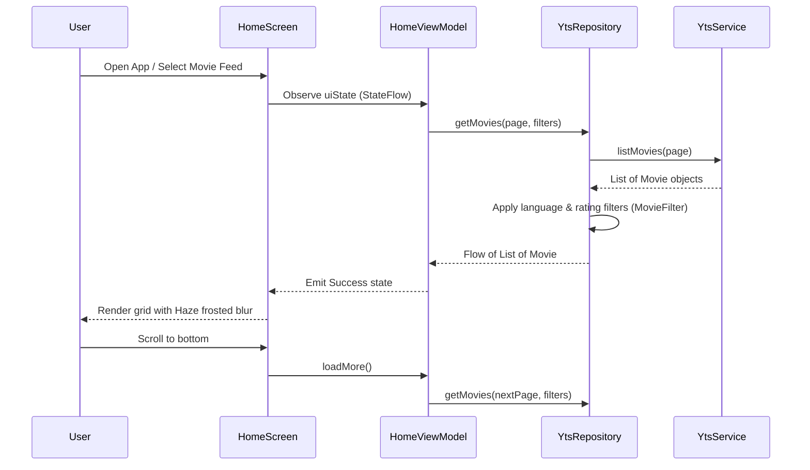

### Diagram 2: Movie Details, TMDB Cast Enrichment & Torrent Launch
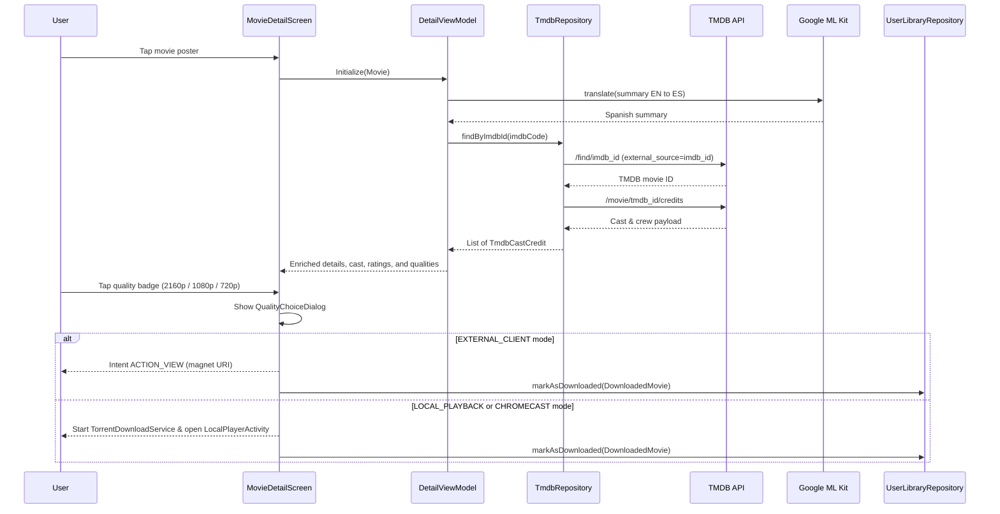

### Diagram 3: In-App Torrent Streaming, Piece Verification & Playback Resume
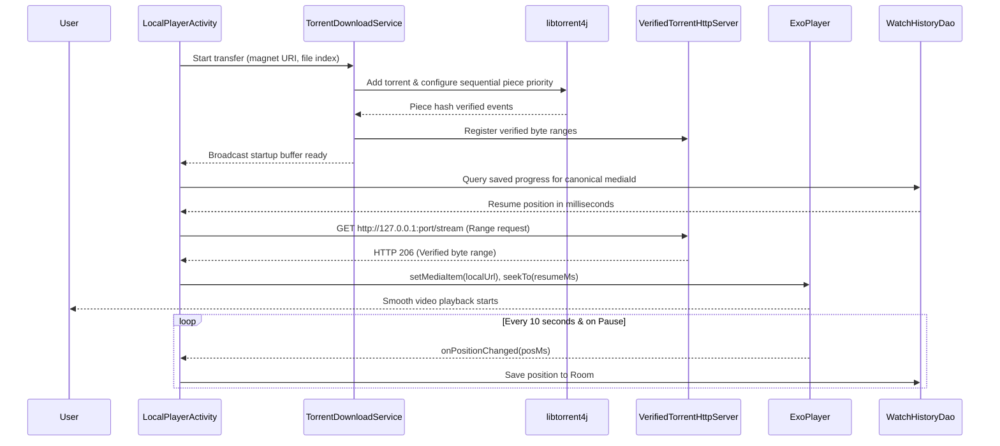

### Diagram 4: TV Series Discovery, Episode Releases & Continuation State
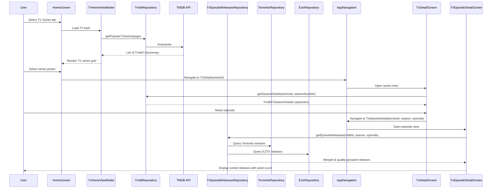

### Diagram 5: Search & Cloud Library (Favorites, Downloads & Actors)
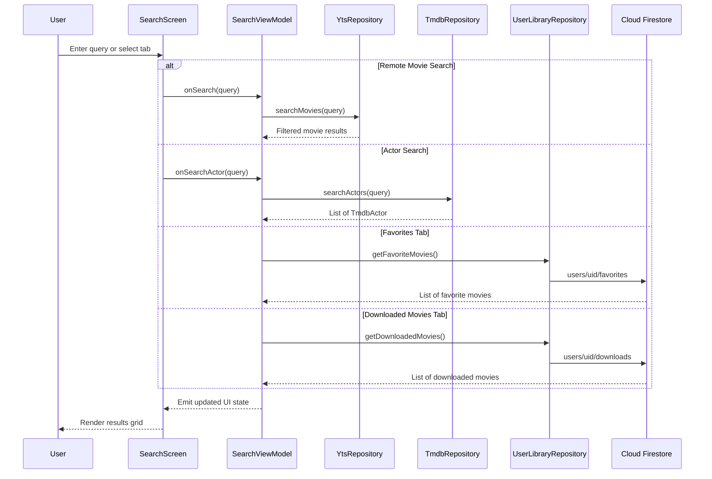

### Diagram 6: Google Credential Manager Authentication & Cloud Sync
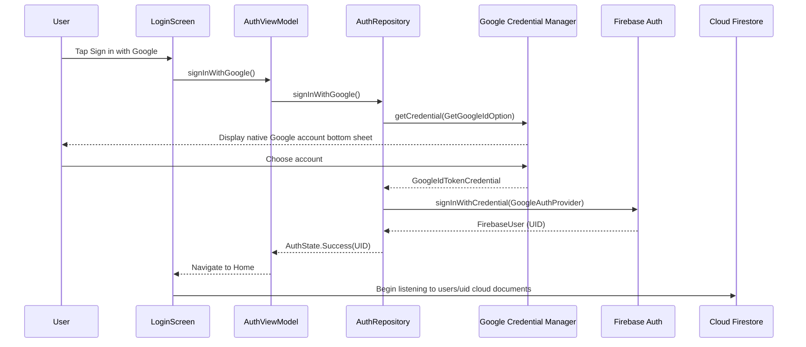

### Diagram 7: Push Notifications & Deep Linking (FCM)
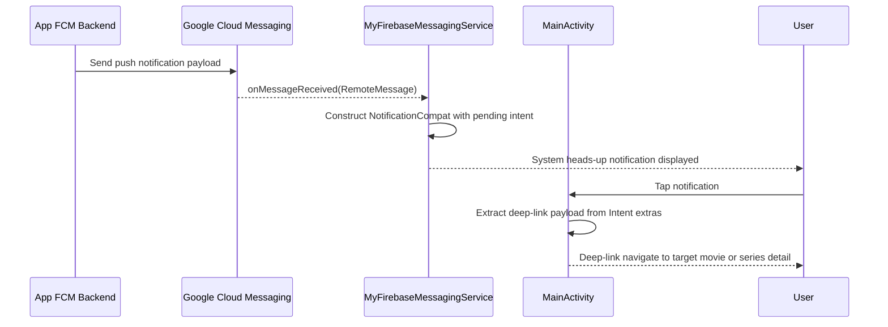

### Diagram 8: In-App Downloads & Transfer Management
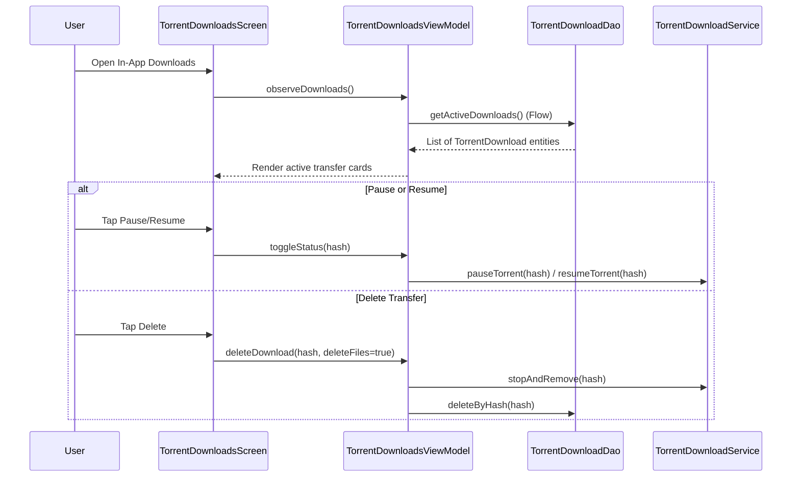

### Diagram 9: Settings, Preferences & Keystore Encryption
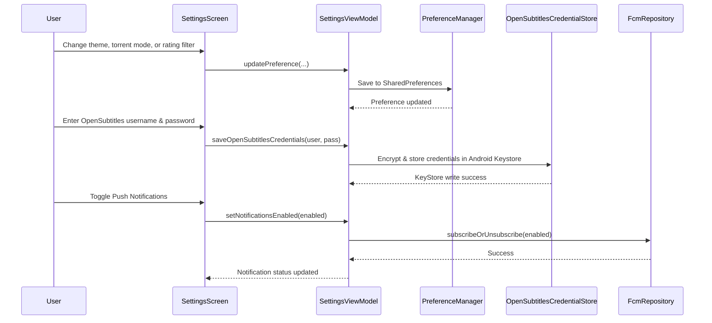

### Diagram 10: Remote Network Media Streaming (SMB / NFS) & Cast Flow
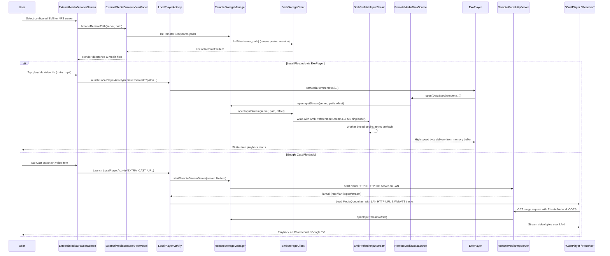

### Diagram 11: OTT Streaming Providers & Catalog Discovery
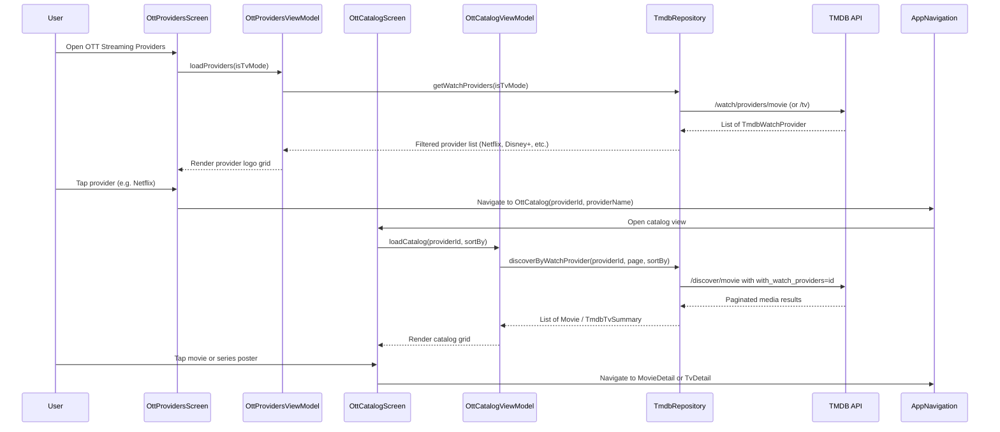

### Diagram 12: Digital Audio Bitstream Passthrough & Surround Transcoding
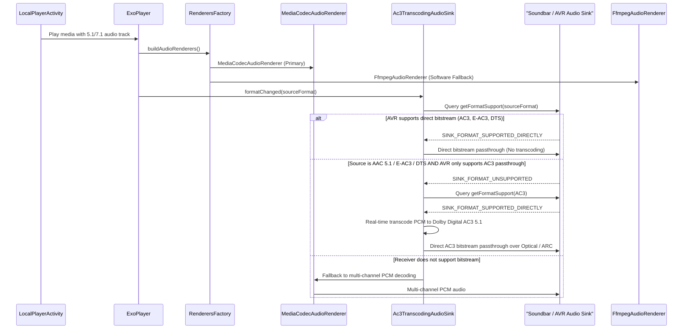

### Diagram 13: Canonical Watch History Media ID & Cross-Source Resume
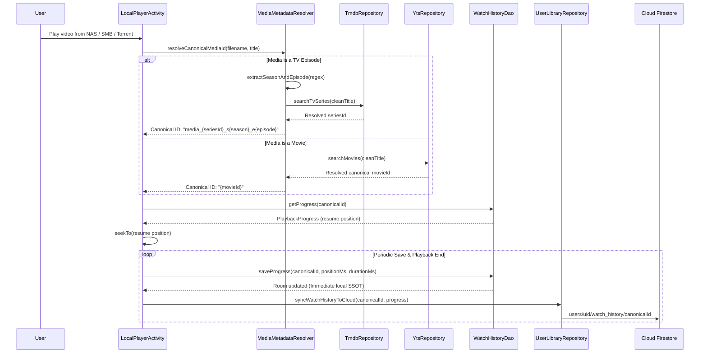

### Diagram 14: Manual Watch Progress & Download Marking System
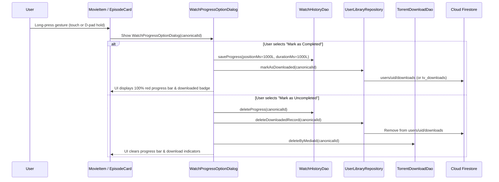

---

## 7. Architectural Integrity & Guidelines Checklist

Before committing modifications to the codebase, verify:
* [x] **Theme Mode Propagation**: `themeMode` is resolved from `PreferenceManager` and passed to BOTH `TvLaTorrentolaTheme` and `LaTorrentolaTheme` in every Dialog, BottomSheet, and Compose entry point.
* [x] **Audio Offload & Tunneling Prohibitions**: Video tunneling and audio offload remain disabled during video streaming, TV playback buffer is set to 2,000ms with a 3,000ms rebuffer cushion, and passthrough buffer duration is capped at 250ms.
* [x] **Surround Transcoding Guardrails**: `EXTENSION_RENDERER_MODE_ON` is preserved (never `_PREFER`), direct passthrough precedes FFmpeg, and AC3 transcoding only activates when the sink directly supports AC3 bitstream passthrough.
* [x] **Remote Media Streaming Performance**: `SmbStorageClient` and `NfsStorageClient` retain cached sessions across seeks, `SmbPrefetchInputStream` buffers 16 MB with recycled pools, and hot-path read loops remain free of `Log.d`.
* [x] **Zero Speculative Player State Flipping**: Player controls command explicit target states (`shouldPause ? pause() : play()`), and `RemoteCastCanvas` uses `RemoteMediaClient` as single state authority.
* [x] **R8 & ProGuard Safety**: Serialization is retained via annotations (`@SerializedName`, `@Serializable`), reflection constructors are preserved, and package-wide wildcard keeps (`{ *; }`) are avoided.
* [x] **Unit Testing Validation**: Run unit tests (`testDebugUnitTest`) to validate all functional changes before marking tasks as complete.
