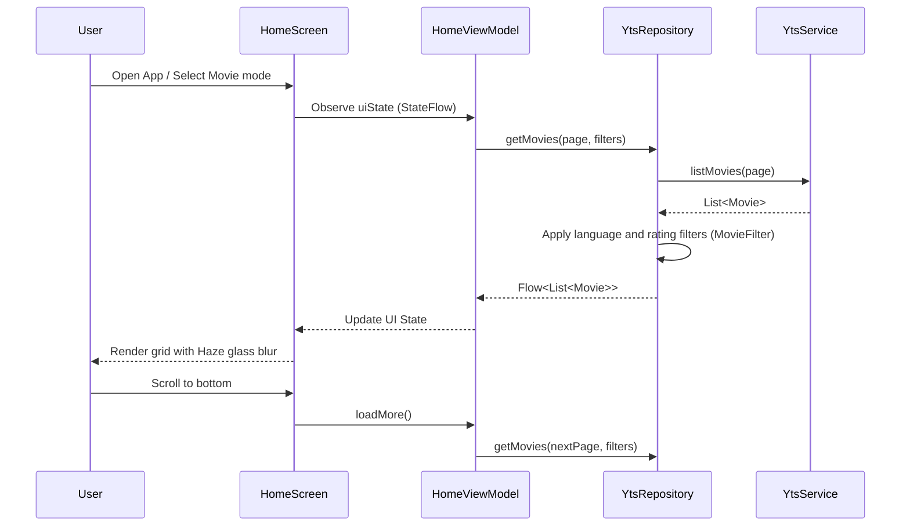
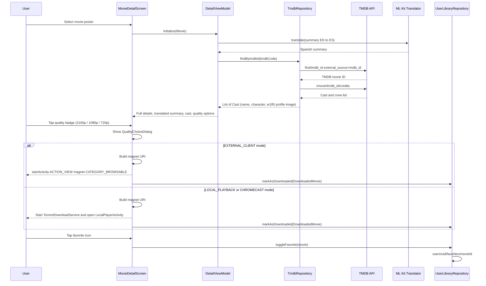
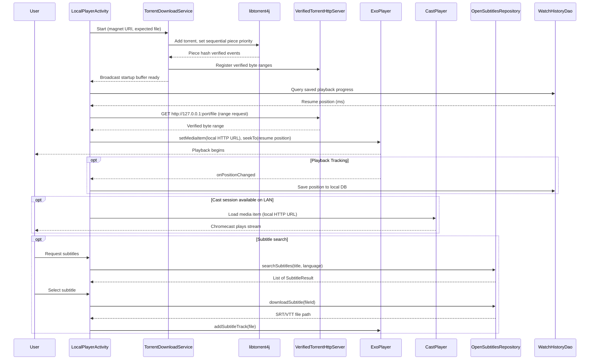
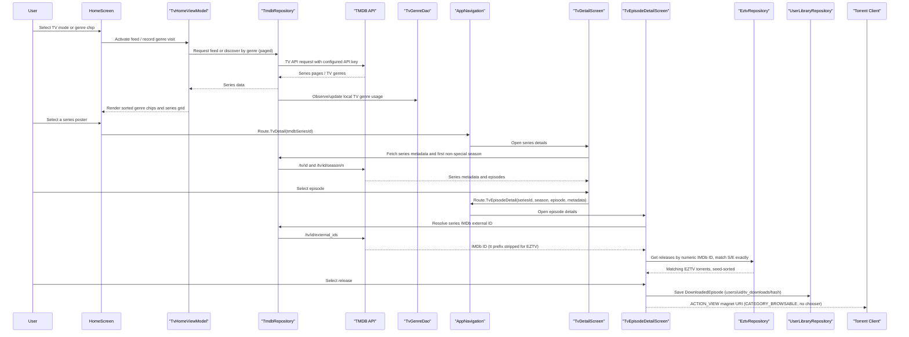
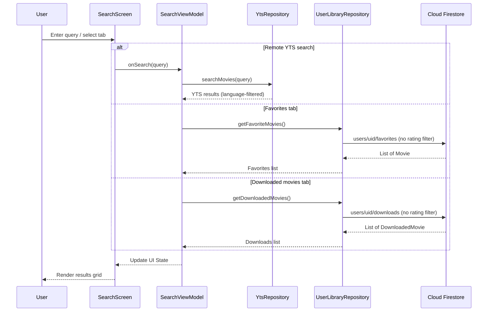
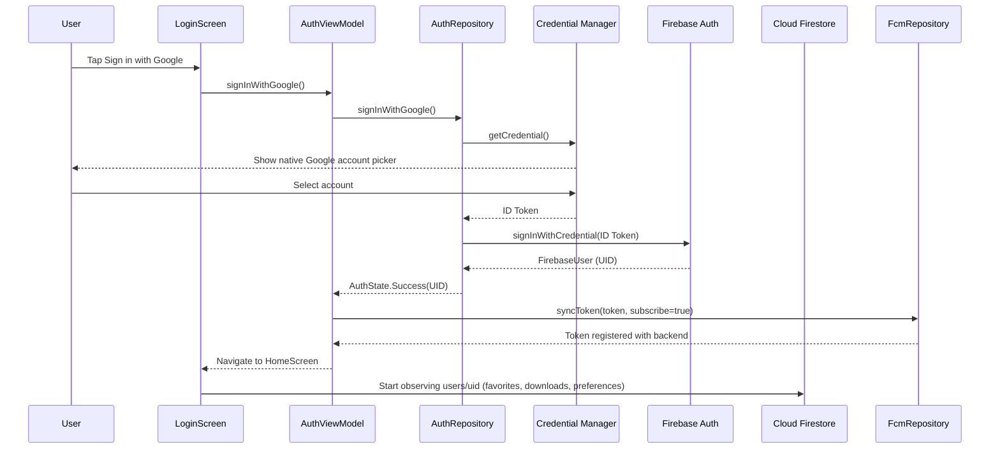
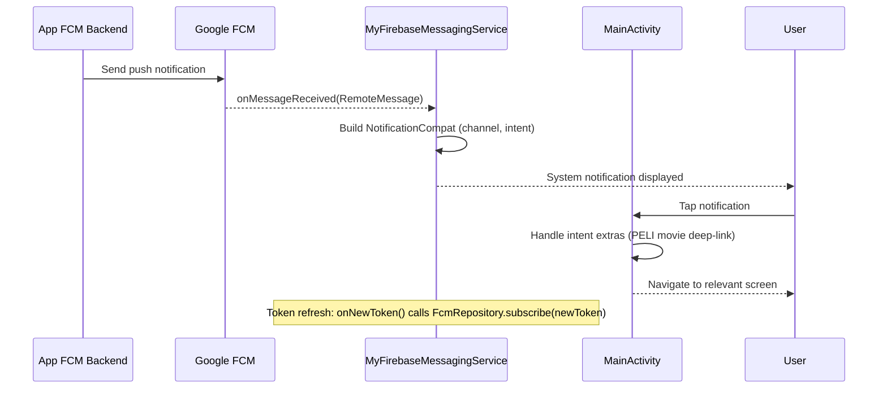
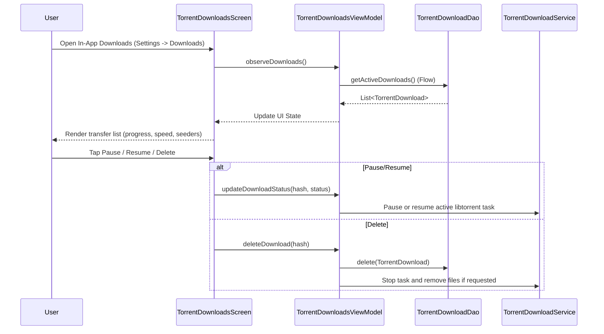

# Architecture & Workflows — La Torrentola

Detailed technical documentation covering system architecture, design patterns, modular UI components, and data flow diagrams for **La Torrentola**.

---

## 🏗️ System Architecture Overview

The application follows **Android Clean Architecture** principles paired with reactive **MVVM (Model-View-ViewModel)**. It is structured as a **Single-Activity App** using Jetpack Compose and AndroidX Navigation 3.

```mermaid
graph TD
    subgraph UI_Layer [UI Layer - Jetpack Compose and TV Material 3]
        MA[MainActivity]
        NV[AppNavigation - Nav3]
        LS[LoginScreen]
        HS[HomeScreen]
        DS[MovieDetailScreen]
        SS[SearchScreen]
        STS[SettingsScreen]
        TVGR[TvGenreResultsScreen]
        TVDS[TvDetailScreen]
        TVES[TvEpisodeDetailScreen]
        TDS[TorrentDownloadsScreen]
        EMBS[ExternalMediaBrowserScreen]
        LPA[LocalPlayerActivity]

        subgraph Modular_Components [Reusable Components - ui/components]
            ML[MovieList]
            MI[MovieItem]
            AC[AdaptiveChip/Chips]
            TVC[TvCatalogComponents/TvSeriesGrid]
            GB[GenreBottomSheet]
            AB[ActorDetailBottomSheet]
            PL[Placeholders]
            QD[QualityChoiceDialog]
        end
    end

    subgraph Presentation_Layer [Presentation Layer - ViewModels]
        AVM[AuthViewModel]
        HVM[HomeViewModel]
        DVM[DetailViewModel]
        SVM[SearchViewModel]
        STVM[SettingsViewModel]
        TVHVM[TvHomeViewModel]
        TVGVM[TvGenreResultsViewModel]
        TVDVM[TvDetailViewModel]
        TVEVM[TvEpisodeDetailViewModel]
        TDVM[TorrentDownloadsViewModel]
        EMBVM[ExternalMediaBrowserViewModel]
        TPVM[TvPlayerViewModel]
    end

    subgraph Data_Layer [Data Layer]
        AREP[AuthRepository]
        UREP[UserLibraryRepository - Firestore]
        REP[YtsRepository]
        RS[YtsService - Retrofit]
        TR[TmdbRepository / TmdbService]
        ER[EztvRepository / EztvService]
        OSR[OpenSubtitlesRepository / Service]
        FCMR[FcmRepository / FcmService]
        DB[AppDatabase - Room]
        GENDAO[GenreDao]
        TVGDAO[TvGenreDao]
        TDAO[TorrentDownloadDao]
        DATEDAO[DateDao]
        WDAO[WatchHistoryDao]
        MLK[ML Kit Translator]
        PM[PreferenceManager]
        TDS_SVC[TorrentDownloadService - Foreground]
        HTTP[VerifiedTorrentHttpServer]
        RSM[RemoteStorageManager]
        SMB[SmbStorageClient - smbj]
        NFS[NfsStorageClient - libnfs JNI]
        RMDS[RemoteMediaDataSource]
        RMHTTP[RemoteMediaHttpServer]
        SMBCS[SmbCredentialStore]
        RSR[RemoteServerRepository]
        NSS[NetworkStorageScanner]
    end

    subgraph External [External APIs, Network and Services]
        YTS[YTS API]
        TMDB[TMDB API]
        EZTV[EZTV API]
        OSAPI[OpenSubtitles API]
        FCMBE[App FCM Backend]
        FIREBASE[Firebase Auth and Firestore]
        CAST[Chromecast / Cast SDK]
        NAS[Home NAS / PC - SMBv2/v3 and NFSv3/v4]
    end

    MA --> NV
    NV --> LS & HS & DS & SS & STS & TDS & EMBS
    NV --> TVGR & TVDS & TVES
    MA --> LPA

    HS & SS --> ML & AC & PL
    TVGR & TVDS & TVES --> TVC & PL
    DS --> MI & PL & QD & AB
    TVES --> QD
    STS --> TDS & EMBS

    LS --> AVM
    HS --> HVM & TVHVM
    DS --> DVM
    SS --> SVM
    STS --> STVM
    TVGR --> TVGVM
    TVDS --> TVDVM
    TVES --> TVEVM
    TDS --> TDVM
    EMBS --> EMBVM
    LPA --> TPVM

    AVM --> AREP
    AREP -->|Firebase Auth| FIREBASE
    HVM & DVM & SVM & STVM & TVDVM & TVEVM --> UREP
    UREP -->|Firestore| FIREBASE
    HVM & DVM & SVM --> REP
    STVM --> PM & FCMR
    REP --> RS & DB & MLK & UREP
    RS -->|YTS API| YTS
    TVHVM & TVGVM & TVDVM & TVEVM --> TR
    TVEVM --> ER
    TR --> TVGDAO
    TR -->|TMDB API| TMDB
    ER -->|EZTV API| EZTV
    TVGDAO --> DB
    GENDAO --> DB
    TDAO --> DB
    DATEDAO --> DB
    WDAO --> DB
    DVM & TVEVM --> OSR
    OSR -->|OpenSubtitles API| OSAPI
    STVM --> UREP
    FCMR -->|FCM backend| FCMBE
    TDVM --> TDAO
    TDS_SVC --> TDAO & HTTP
    EMBVM --> RSM & NSS & RSR & SMBCS
    RSM --> SMB & NFS & RSR & SMBCS
    SMB & NFS -->|LAN Storage| NAS
    LPA --> TDS_SVC & HTTP & OSR & UREP & WDAO & RMDS & RMHTTP
    LPA -->|Cast SDK| CAST
    RMHTTP -->|Cast Stream LAN Proxy| CAST
```



**Dual catalog design:** Home hosts two independent feeds. The movie path sources from YTS using the `Movie` model; the TV path sources from TMDB using `TmdbTvSummary`/`TmdbTvEpisode`. Series IDs remain TMDB IDs throughout navigation. EZTV lookup is keyed by the linked IMDb ID (numeric part only, `tt` prefix stripped).

### TV Subsystem Entry Points

| Concern | Main implementation |
|---|---|
| Home feeds, genre chips, series grid, and focus state | `ui/home/HomeScreen.kt`, `ui/home/TvHomeViewModel.kt`, `ui/components/TvCatalogComponents.kt` |
| TV genre discovery and sorting | `ui/home/TvGenreResultsScreen.kt`, `ui/home/TvGenreResultsViewModel.kt` |
| Series/season/episode details | `ui/detail/TvDetailScreen.kt`, `TvDetailViewModel.kt` |
| Episode release lookup, magnet launch, and episode record creation | `ui/detail/TvEpisodeDetailScreen.kt`, `TvEpisodeDetailViewModel.kt` |
| TMDB and EZTV transport/data access | `network/TmdbService.kt`, `TmdbRepository.kt`, `EztvService.kt`, `EztvRepository.kt` |
| Local genre usage and cloud episode history | `database/TvGenreDao.kt`, `model/stats/TvGenreStats.kt`, `model/user/DownloadedEpisode.kt`, `network/UserLibraryRepository.kt` |
| Typed route definitions and screen transitions | `ui/navigation/AppNavigation.kt` |

### In-App Torrent & Playback Subsystem

| Concern | Main implementation |
|---|---|
| Download orchestration (libtorrent4j), piece verification, and queue | `service/TorrentDownloadService.kt` |
| Verified HTTP byte-range server for local & Cast playback | `service/VerifiedTorrentHttpServer.kt` |
| Local ExoPlayer + Cast player activity | `ui/player/LocalPlayerActivity.kt`, `ui/player/TvPlayerViewModel.kt` |
| Watch History tracking & persistence | `database/WatchHistoryDao.kt`, `network/UserLibraryRepository.kt` |
| In-app download management screen | `ui/downloads/TorrentDownloadsScreen.kt`, `TorrentDownloadsViewModel.kt` |
| Torrent mode setting (`EXTERNAL_CLIENT` / `LOCAL_PLAYBACK` / `CHROMECAST`) | `model/torrent/TorrentHandlingMode.kt` |
| Subtitle search and download | `network/OpenSubtitlesRepository.kt`, `OpenSubtitlesService.kt`, `OpenSubtitlesCredentialStore.kt` |
| Persistent in-app transfer records | `database/TorrentDownloadDao.kt`, `model/torrent/TorrentDownload.kt` |

### Remote Network Storage Subsystem (SMB & NFS)

| Concern | Main implementation |
|---|---|
| Remote storage manager & unified protocol router | `service/storage/remote/RemoteStorageManager.kt` |
| SMB protocol client (smbj 0.15.0) & session pooling | `service/storage/remote/SmbStorageClient.kt` |
| NFS protocol client (native C `libnfs` JNI wrapper) | `service/storage/remote/NfsStorageClient.kt`, `LibNfsNative.kt` |
| Asynchronous prefetch worker & 16 MB ring buffer | `service/storage/remote/SmbPrefetchInputStream.kt` |
| Direct Media3 remote DataSource (`remote://`) | `service/storage/remote/RemoteMediaDataSource.kt`, `PlayerStreamingConfig.kt` |
| Local HTTP byte-range proxy server for Chromecast | `service/storage/remote/RemoteMediaHttpServer.kt` |
| Hardware Keystore encrypted credential storage (SMB) | `service/storage/remote/SmbCredentialStore.kt` |
| Saved server configurations repository | `service/storage/remote/RemoteServerRepository.kt` |
| LAN server discovery scanner (SMB/NFS port probes) | `service/storage/remote/NetworkStorageScanner.kt` |
| External & network storage browser UI | `ui/media/ExternalMediaBrowserScreen.kt`, `ExternalMediaBrowserViewModel.kt` |

---

## 🎨 UI Architecture & Visual System

### 1. Adaptive & Responsive UI (`isTvDevice`)
* **Shared Logic, Split Presentation**: The application logic (ViewModels/Repositories) is shared across mobile and Android TV, but the UI presentation layer completely branches based on `Context.isTvDevice()`.
* **Theme Injection**: Mobile uses `LaTorrentolaTheme(themeMode = preferenceManager.getTheme())` utilizing `androidx.compose.material3`. TV uses `TvLaTorrentolaTheme` utilizing `androidx.tv.material3`.
* **Adaptive Breakpoints**: Where TV components aren't explicitly used on mobile/tablet, Compose Window Size Classes determine layout span counts and navigation rail vs bottom bar presence.

### 2. Haze 2.0 Visual Blur System
* **Platform Requirements**: Hardware-accelerated real-time blur (`RenderEffect`) requires Android 12+ (API 31+).
* **Pre-Android 12 Fallback**: On devices running API < 31 and during Android Studio Compose Previews, the app falls back to a semi-opaque surface container (`surface.copy(alpha = 0.9f)`) to prevent invisible or overlapping content.
* **Animated Interpolation (`EaseInOutCubic`)**: Translucent opacity (`hazeAlpha`) is calculated dynamically based on grid scroll state (`gridState`). It interpolates smoothly between `1.0f` (at rest at the top) and `0.15f` (when scrolled) over 600 ms using `EaseInOutCubic`.
* **Full-Screen `hazeSource`**: The scrollable list container fills the entire screen (`fillMaxSize()`) behind the top header and bottom system navigation bar, delivering a true edge-to-edge frosted glass experience.

### 3. Android TV D-Pad Focus Navigation Engine
* **Single Vertical Layout Tree (`isTv`)**: On TVs and Chromecasts (`isTv == true`), headers and grid lists reside in a single vertical `Column` layout tree. This eliminates focus search dead zones between filter chips and grid items.
* **Native TV Components (`androidx.tv.material3.Surface`)**: All chips and buttons on TV use `tv-material3` components (`TvChip`), providing smooth focus scaling (`focusedScale = 1.1f` or `1.05f`).
* **Dialog Focus Trapping**: Android TV overlays use `androidx.compose.ui.window.Dialog` to prevent the D-pad focus engine from falling through to the underlying views (crucial for overlapping ExoPlayer surfaces).
* **YouTube Player Focus Isolation**: Embedded `YouTubePlayerView` instances block D-pad focus stealing via `descendantFocusability = ViewGroup.FOCUS_BLOCK_DESCENDANTS`, overlaying a native `IconButton` for play/pause control.

---

## 📦 Data Layer & Hybrid Persistence

1. **Retrofit + Gson**: Fetches movie catalog data from the YTS API.
2. **TMDB Retrofit service**: Supplies TV feeds, genres, genre discovery, TV details, seasons/episodes, cast/crew enrichment for movies via IMDb ID, and series external IDs. `TMDB_API_KEY` is injected via `BuildConfig`; it must not be hardcoded.
3. **EZTV Retrofit service**: Supplies torrent releases for a numeric IMDb ID. `EztvRepository` filters by exact season/episode and sorts matches by seed count.
4. **OpenSubtitles Retrofit service**: Searches and downloads subtitle tracks. Credentials (username/password) are securely encrypted inside the Android hardware Keystore via `OpenSubtitlesCredentialStore`; the API key is injected via `BuildConfig`.
5. **libtorrent4j (`TorrentDownloadService`)**: Foreground service managing a native libtorrent session. Downloads are queued, pieces are hash-verified, and byte ranges are served via `VerifiedTorrentHttpServer` only after verification. Raises `minSdk` to Android 9 (API 28).
6. **Media3 ExoPlayer + Cast SDK (`LocalPlayerActivity`)**: Plays media from the local HTTP server. Switches between `ExoPlayer` (local) and `CastPlayer` (Chromecast) when a Cast session becomes available on the same LAN.
7. **Cloud Firestore (Cloud-First Sync)**: Synchronizes user favorites and movie downloads (`users/{uid}/downloads/{hash}`) separately from TV episode downloads (`users/{uid}/tv_downloads/{hash}`). Also stores per-user cloud preferences (language filter, minimum rating).
8. **Room Database (Local Metadata)**: Acts as the Single Source of Truth for rapid UI access. Stores:
   * **Watch History**: `WatchHistoryDao` (Fast local UI resume, syncs to Firestore in background).
   * **Transfer Records**: `TorrentDownloadDao`.
   * **Usage Stats**: `GenreDao`, `TvGenreDao`, `DateDao`.
9. **Google ML Kit Translate**: On-device AI translation of movie summaries from English to Spanish.
10. **Firebase Cloud Messaging**: Push notifications managed by `FcmRepository`/`FcmService`. Token is registered with the app backend on sign-in and removed on sign-out. Deep linking implemented via Notification intents.
11. **SMB & NFS Network Storage (`RemoteStorageManager`)**: Direct access to local network media servers using `smbj` (SMBv2/v3) and native C `libnfs` JNI wrapper (NFSv3/v4). Host credentials for SMB shares are encrypted in the Android Keystore via `SmbCredentialStore`.
12. **High-Performance Streaming Pipeline (`RemoteMediaDataSource` & `SmbPrefetchInputStream`)**: High-throughput media pipeline for local playback and Cast streaming. Uses custom `remote://` URI routing directly in Media3 ExoPlayer, asynchronous 16 MB ring-buffered prefetching (`SmbPrefetchInputStream`) to eliminate SMB stop-and-wait stalls, persistent session reuse, and a dedicated LAN HTTP proxy server (`RemoteMediaHttpServer`) for Chromecast receivers.

---

## 🔄 Sequence & Flow Diagrams

### 1. Movie Discovery & Pagination


### 2. Movie Details, TMDB Cast Enrichment & Torrent Mode Selection


### 3. In-App Torrent Download, Playback, Watch History & Cast


### 4. TV Series Discovery, Episode Releases & Downloads


### 5. Search & Cloud Library


### 6. Google Credential Manager Authentication


### 7. Push Notifications & Deep Linking (FCM)


### 8. In-App Downloads & Transfer Management


### 9. Settings, Preferences & Secure Credential Storage
```mermaid
sequenceDiagram
    participant U as User
    participant SS as SettingsScreen
    participant VM as SettingsViewModel
    participant PM as PreferenceManager
    participant KS as OpenSubtitlesCredentialStore
    participant FCMR as FcmRepository

    U->>SS: Change theme, torrent mode, or language filter
    SS->>VM: updatePreference(...)
    VM->>PM: Save value to SharedPreferences
    PM-->>VM: Updated preference state
    U->>SS: Enter OpenSubtitles username & password
    SS->>VM: saveOpenSubtitlesCredentials(user, pass)
    VM->>KS: Encrypt & store credentials in Android Keystore
    KS-->>VM: Success
    U->>SS: Toggle Push Notifications
    SS->>VM: setNotificationsEnabled(enabled)
### 10. Remote Network Media Streaming (SMB / NFS) & Cast Flow
```mermaid
sequenceDiagram
    participant U as User
    participant EMBS as ExternalMediaBrowserScreen
    participant EMBVM as ExternalMediaBrowserViewModel
    participant RSM as RemoteStorageManager
    participant SMB as SmbStorageClient
    participant PREFETCH as SmbPrefetchInputStream
    participant RMDS as RemoteMediaDataSource
    participant EXO as ExoPlayer
    participant RMHTTP as RemoteMediaHttpServer
    participant CAST as CastPlayer / Receiver

    U->>EMBS: Select configured SMB / NFS server
    EMBS->>EMBVM: browseRemotePath(server, path)
    EMBVM->>RSM: listRemoteFiles(server, path)
    RSM->>SMB: listFiles(server, path) (reuses cached session)
    SMB-->>EMBVM: List<RemoteFileItem>
    EMBVM-->>EMBS: Render directories & playable media files

    alt Local Playback via ExoPlayer
        U->>EMBS: Tap playable video file (.mkv, .mp4, etc.)
        EMBS->>LPA: Launch LocalPlayerActivity(remote://serverId?path=...)
        LPA->>EXO: setMediaItem(remote://...)
        EXO->>RMDS: open(DataSpec(remote://..., position, length))
        RMDS->>RSM: openInputStream(server, path, offset)
        RSM->>SMB: openInputStream(server, path, offset)
        SMB->>PREFETCH: Wrap with SmbPrefetchInputStream(16 MB capacity)
        PREFETCH-->>PREFETCH: Background worker begins asynchronous read ahead
        RMDS-->>EXO: Instant byte availability from memory buffer
        EXO-->>U: Smooth zero-stutter local playback begins
    else Google Cast Playback
        U->>EMBS: Tap Cast button on video item
        EMBS->>LPA: Launch LocalPlayerActivity(EXTRA_CAST_URL, castImmediately=true)
        LPA->>RSM: startRemoteStreamServer(server, fileItem)
        RSM->>RMHTTP: Start NanoHTTPD HTTP 206 range server on LAN
        RMHTTP-->>LPA: lanUrl (http://<LAN_IP>:<PORT>/stream?...)
        LPA->>CAST: Load MediaQueueItem with LAN HTTP URL & WebVTT tracks
        CAST->>RMHTTP: GET range request with CORS headers
        RMHTTP->>RSM: openInputStream(offset)
        RMHTTP-->>CAST: Stream video bytes over LAN
        CAST-->>U: Seamless TV playback on Chromecast / Google TV
    end
```

---

## 🌐 Remote Media Storage & Streaming Architecture

### 1. Unified Client Abstraction (`RemoteStorageManager`)
`RemoteStorageManager` acts as the single facade orchestrating remote file discovery, folder navigation, read streams, and server lifecycle across protocols:
* **Protocol Routing**: Routes calls to `SmbStorageClient` for `RemoteServerType.SMB` and `NfsStorageClient` for `RemoteServerType.NFS`.
* **Zero Loopback Overhead for Local Playback**: Unlike conventional media players that mandate an internal HTTP proxy daemon for all network files, La Torrentola registers `RemoteMediaDataSource` directly into Media3's `DataSource.Factory`. Media3 interacts natively with `openInputStream(offset)` and `read()`, avoiding loopback socket overhead.

### 2. Protocol Engine Details & Session Management

#### A. NFS (Native C `libnfs` JNI Wrapper)
* **Underlying Engine**: Uses the high-performance native C library `libnfs` compiled via Android NDK, accessed through `LibNfsNative.kt`.
* **Performance Profile**: Direct UNIX socket I/O with native RPC framing. Provides high sequential throughput and near-zero latency on seek operations.
* **Session Lifecycle**: Connections are cached in `NfsStorageClient.sessionCache`. Closing an `InputStream` closes the native file descriptor (`nfs_close`) while preserving the mounted RPC export context.

#### B. SMB (Server Message Block via `smbj` 0.15.0)
* **Underlying Engine**: Implements SMB2 and SMB3 dialects (SMB 2.1, 3.0, 3.1.1) in pure Kotlin/Java via `com.hierynomus:smbj`.
* **Authentication & Keystore**: Supports guest sessions and NTLMv2 authenticated sessions. Passwords are encrypted at rest using AES-GCM via the Android hardware Keystore (`SmbCredentialStore`).
* **Session & TreeConnect Caching**: `SmbStorageClient.sessionCache` pools active `SmbSession` and `DiskShare` instances keyed by `host:port:share:username`. Opening a file against an active session takes ~1ms (1 single `SMB2 CREATE` round-trip) instead of ~150ms (6 round-trips for TCP connect, negotiate, session setup, and tree connect).
* **Stream Disconnect Isolation**: Closing an `InputStream` MUST ONLY invoke `File.close()`. The underlying `DiskShare` and `SmbSession` remain cached and active for subsequent seeks and reads.

### 3. Asynchronous Prefetch Engine (`SmbPrefetchInputStream`)
Network file protocols (specifically SMB) operate over synchronous request/response message packets. When ExoPlayer's media extractor executes synchronous small-buffer reads (e.g. 32 KB or 64 KB) in its decoding loop, network roundtrip latency causes extractor starvation, resulting in persistent rebuffering and frame drops.

To solve this, `SmbPrefetchInputStream` decouples network I/O from player consumption:
* **Dedicated Worker Thread**: A background thread continuously fetches 1 MB chunks sequentially ahead of the player's read position.
* **16 MB Pooled Capacity**: Holds up to 16 chunks in memory ahead of the playback cursor, fully absorbing network jitter and Wi-Fi latency spikes.
* **Buffer Recycling**: When chunks are consumed, their backing `ByteBuffer` instances are returned to a thread-safe `ArrayDeque` pool instead of being discarded, completely eliminating GC allocations and GC-pause frame stutters.
* **Thread Synchronization**: Uses atomic offsets and monitor waits (`wait()` / `notifyAll()`) to pause the worker when the buffer is full and awaken it immediately when the player consumes data.

### 4. Player Buffer Configuration (`PlayerStreamingConfig`)
`PlayerStreamingConfig.buildLoadControl()` configures ExoPlayer's `DefaultLoadControl`:
* **`prioritizeTimeOverSizeThresholds = true`**: Prevents ExoPlayer from halting buffer loads early when playing high-bitrate video where file size limits would otherwise trigger premature stopping.
* **Device-Tailored Buffer Targets**:
  * **Android TV**: 48 MB target buffer, 15s to 45s playback buffer range, 2s playback start threshold, 10s retained back-buffer.
  * **Mobile / Tablet**: 32 MB target buffer, 15s to 30s playback buffer range, 1.5s playback start threshold, 10s retained back-buffer.

### 5. Google Cast Integration & HTTP Proxy (`RemoteMediaHttpServer`)
Chromecast CAF receivers do not support custom Android URI schemes (`remote://`). When casting remote network files:
1. `RemoteStorageManager.startRemoteStreamServer(server, fileItem)` instantiates a lightweight `RemoteMediaHttpServer` (powered by NanoHTTPD).
2. The server exposes HTTP byte-range requests (`206 Partial Content`) on the device's local LAN IP (`http://<LAN_IP>:<PORT>/stream?...`).
3. CORS headers (`Access-Control-Allow-Origin: *`, `Access-Control-Allow-Private-Network: true`) are served on all responses and `OPTIONS` preflights.
4. If subtitles are present or downloaded via OpenSubtitles, they are converted to WebVTT format and served from the same server for native Chromecast display.

---

## 🔐 Identity and Ownership Notes

- **TV ID Bridging**: TV catalog, genre discovery, and details are TMDB-backed. Torrent release metadata is EZTV-backed. Navigation carries the TMDB series ID plus season/episode identity. The TMDB external-ID endpoint bridges to IMDb; EZTV expects the numeric part without `tt`.
- **Hybrid Persistence Paradigm**: Room stores local fast-access metadata (Watch History, transfer records, local usage statistics). Firestore acts as the definitive cloud backup (favorites, downloaded entities, preferences). **Data flow enforces Room as the Single Source of Truth for immediate UI reflection**, syncing to Firestore in the background. User collections (favorites, downloads) bypass runtime threshold filters like minimum rating.
- **Security Compliance**: Sensitive OpenSubtitles credentials exist only transiently in memory, encrypted at rest via the Android Keystore.
- **Network Storage Credentials**: SMB passwords entered by users are encrypted via `SmbCredentialStore` backed by the Android Keystore, ensuring plaintext credentials never touch unencrypted storage.
